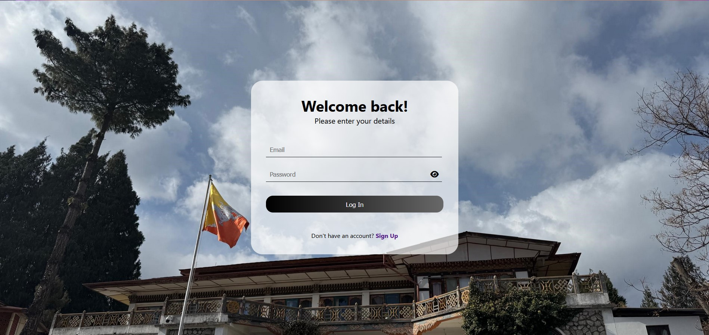
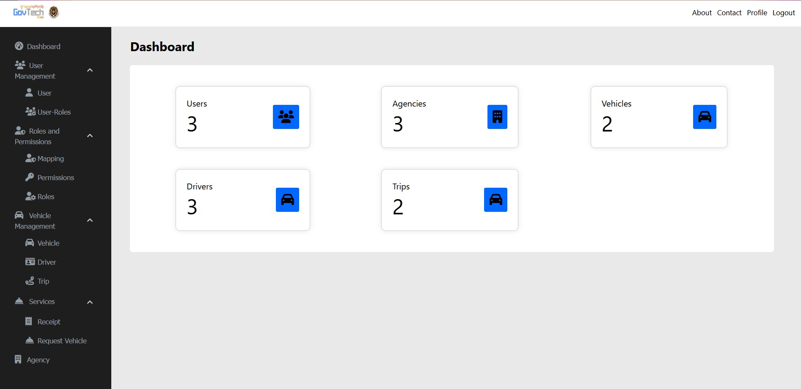
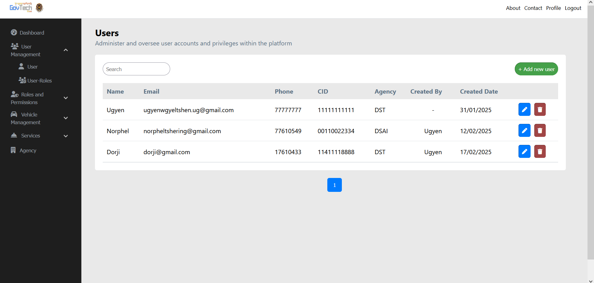
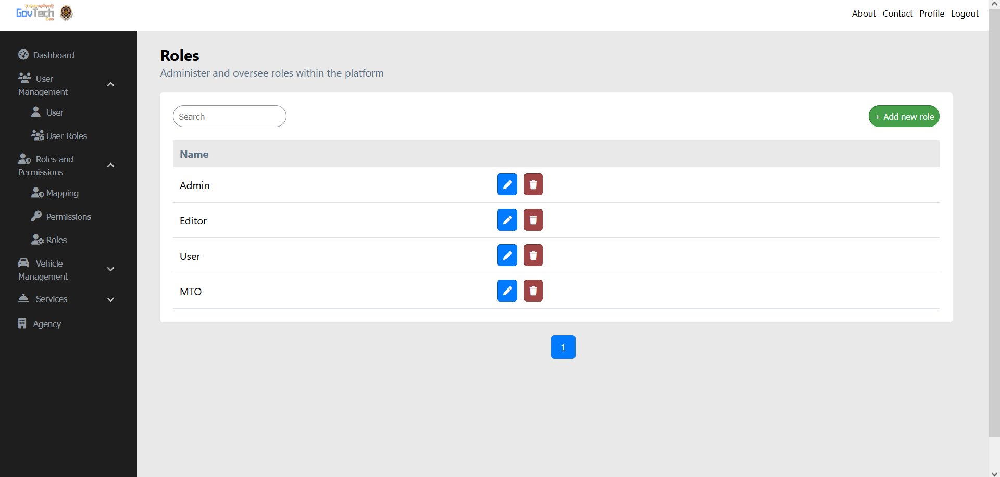
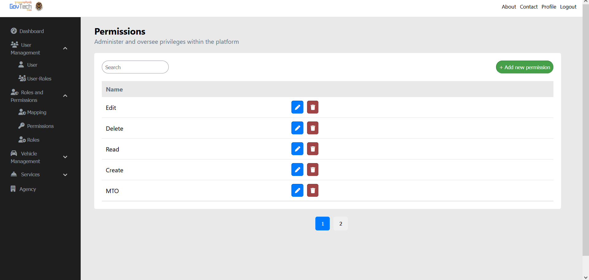
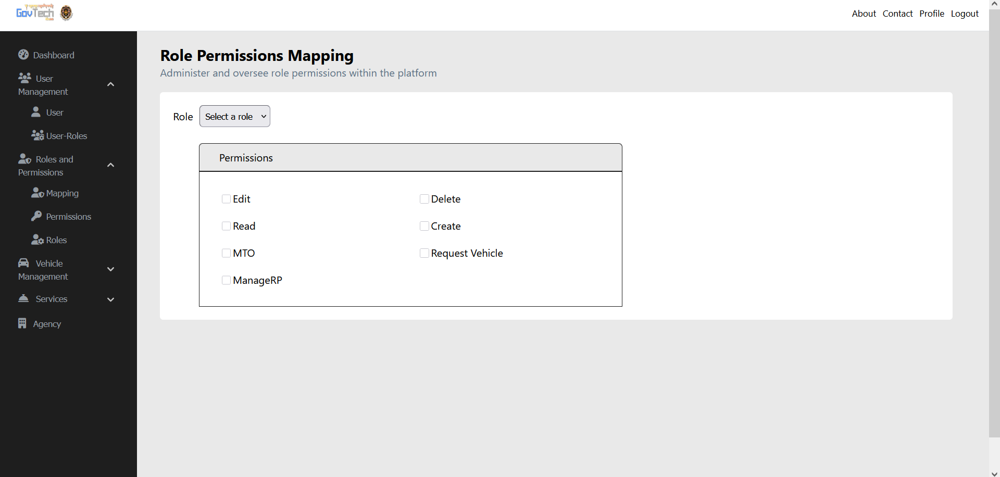
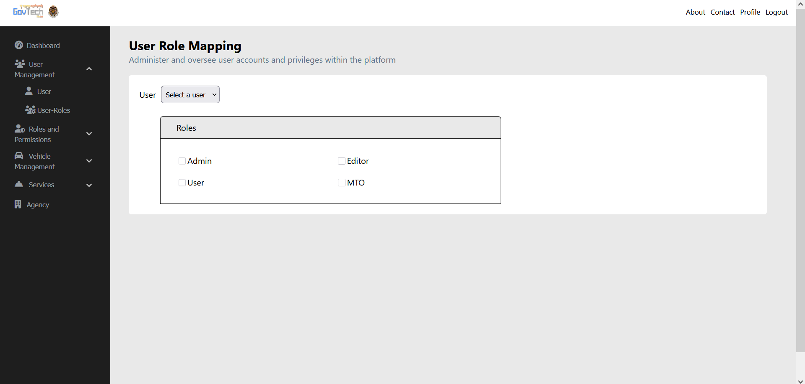
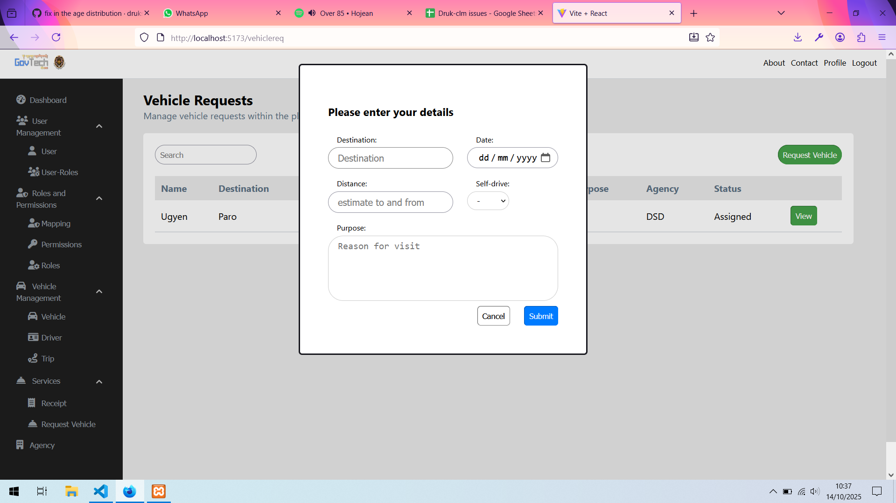
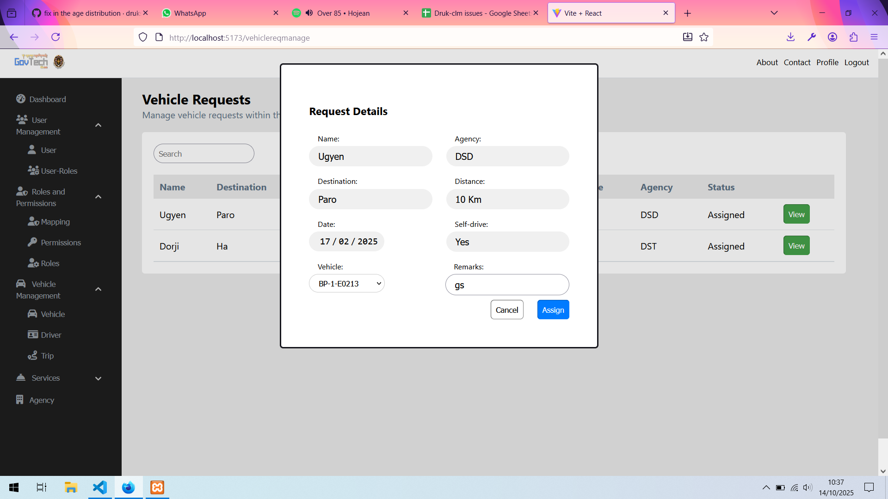

# User Management System

The User Management System enables basic CRUD operations for user accounts, including registration, login, profile management, role/permissions control, etc.  
It consists of:

- **Backend**: handles APIs, business logic, data persistence  
- **Frontend**: user interface (web) for managing users  

## Features

- User registration & login  
- JWT-based authentication  
- Role-based access control  
- CRUD operations: User, Role, Agency, Permission, Vehicle, Driver,  
- Profile management
- Vehicle Request 

## Tech Stack

| Layer | Technology / Framework |
|---|---|
| Frontend | ReactJS
| Backend | Node.js, Express  |
| Database | MySQL |
| Authentication | JWT tokens |

## Screens
### Home Page


### Dashboard


### Users


### Roles


### Permissions


### Role & Permissions Mapping


### User & Role Mapping


### Vehicle Request Form


### Vehicle MTO Form


## Setup & Installation

1. Clone the repository:
   ```
   git clone https://github.com/ugy420/UserManagement.git
   cd UserManagement
   ```
2. Install dependencies:<br>
   For frontend:
   ```
   npm install
   ```
   For backend:
   ```
   cd backend
   npm install
   ```

3. Configuration (Environment Variables)

   In the backend folder, create a .env file with contents like:
   ```
   MYSQL_HOST=''
   MYSQL_USER=''
   MYSQL_PASSWORD=''
   MYSQL_DATABASE=''
   JWT_SECRET=''
   EMAIL_USER=''
   EMAIL_PASS=''
   ```

4. Running:

   i. Start frontend server:
      ```
      npm run dev
      ```
   ii. Start backend server:
      ```
      cd backend
      npm run dev
      ```
   After both are running, open your browser and navigate to the frontend URL (e.g. http://localhost:3000 or whichever port it uses).
